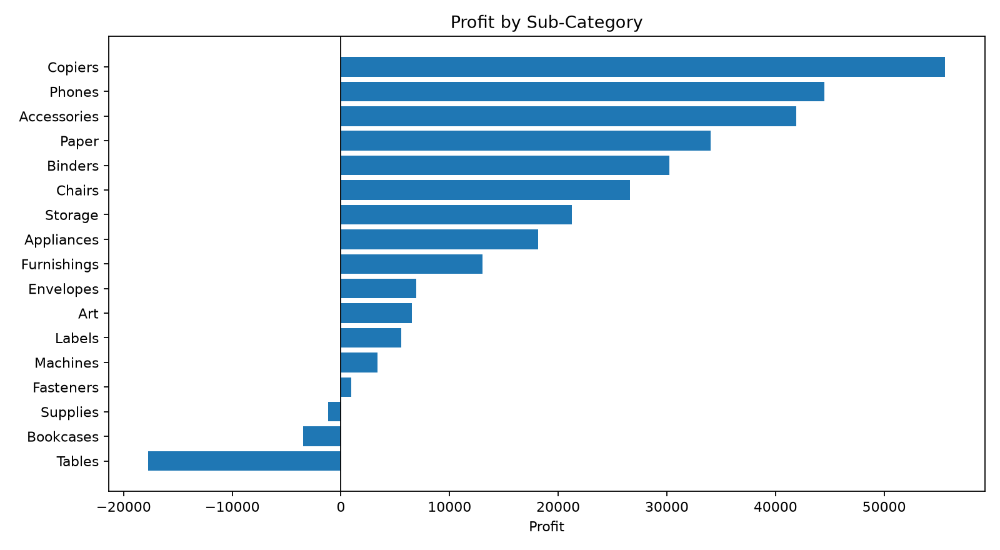
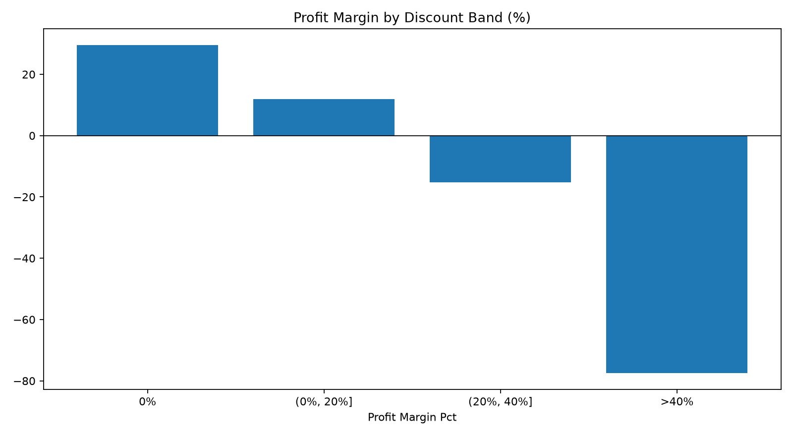

# Superstore Sales & Profit Analysis

**Data Analytics & Business Intelligence | Python · pandas · Matplotlib · Power BI**

An end-to-end retail analytics portfolio project by [Bui Vo Duy Vu](https://github.com/BuiVoDuyVu). It turns historical transaction data into a reproducible analysis of sales performance, profit leakage, and discount patterns, with a Power BI report for further business exploration.

**Workflow:** Data Cleaning → EDA → Data Visualization → Business Insights → Business Recommendations

[Tiếng Việt](docs/README.vi.md) · [Analysis notebook](notebooks/01_superstore_analysis.ipynb) · [Power BI report](powerbi/Superstore_Dashboard.pbix) · [Project report (PDF)](reports/Superstore_Project_Report.pdf) · [Business insights](docs/business_insights.md)

## Business problem

High revenue does not always translate into healthy profit. This project investigates where a retailer earns profit, where it loses money, and which discount patterns warrant closer review.

The analysis answers five practical questions:

1. How do revenue, profit, and weighted profit margin vary by region?
2. Which categories and subcategories contribute to profit or losses?
3. How does profitability differ across discount bands?
4. How do revenue and profit develop over time?
5. Which findings can guide measurable business experiments?

## Dataset and scope

The project uses **Tableau Sample – Superstore**, a historical retail sample dataset distributed through a [pinned CSV mirror](https://gist.github.com/SharmaAshwini/8bd642f6c46792a9c40c8ccad60391e9/4fd45d58a0a81c69814d270d7658f5e2a2d81154).

| Attribute | Scope |
| --- | --- |
| Period | January 3, 2014 – December 30, 2017 |
| Geography | United States; Central, East, South, and West regions |
| Grain | One order line; an order may contain multiple lines |
| Size | 9,994 order lines, 21 source columns |
| Product groups | Furniture, Office Supplies, Technology |
| Currency | USD |

See the [data provenance and reproduction notes](data/README.md) and [data dictionary](docs/data_dictionary.md). This is an educational portfolio analysis; its findings describe the supplied sample rather than current company performance.

## Executive snapshot

| KPI | Result |
| --- | ---: |
| Total sales | **$2,297,200.86** |
| Total profit | **$286,397.02** |
| Weighted profit margin | **12.47%** |
| Distinct orders | **5,009** |
| Distinct customers | **793** |
| Units sold | **37,873** |
| Loss-making order lines | **1,871** |

These results are exported to [kpi.json](reports/tables/kpi.json). Order counts use distinct `Order ID`; margin uses **total profit ÷ total sales**, not the average of line-level percentages.

## Analytical workflow

### 1. Data Cleaning

- Check required columns, missing values, exact duplicates, and duplicate row identifiers.
- Parse the selected source's `DD/MM/YY` dates and validate numeric columns.
- Preserve postal codes as text and retain negative profits as meaningful observations.
- Exclude invalid analysis records and export an audit file; flag duplicates for review.
- Derive `Year`, `YearMonth`, `Discount Group`, and `Loss Line` for analysis and Power BI.

**Observed quality:** all 9,994 source rows passed the implemented checks; there were zero missing cells, exact duplicates, duplicate row IDs, or rejected rows. Cleaning here standardizes and validates the data; it does not remove records from this dataset.

Outputs: [cleaned CSV](data/processed/superstore_clean.csv) · [quality report](reports/data_quality/data_quality.json) · [rejected-record audit](reports/data_quality/data_quality_issues.csv)

### 2. Exploratory Data Analysis (EDA)

Aggregate revenue, profit, quantity, loss-making lines, and weighted margin by region, category, subcategory, discount band, month, year, and region × category. Explore the steps in the [notebook](notebooks/01_superstore_analysis.ipynb), or review the exported [summary tables](reports/tables/).

### 3. Data Visualization

Four Python charts communicate geographic performance, subcategory losses, discount profitability, and monthly revenue. The downloadable [Power BI report](powerbi/Superstore_Dashboard.pbix) complements these static outputs; [setup instructions and DAX definitions](powerbi/README.md) explain how to reconnect the data after cloning.

**Where profit is generated — and lost**



**Profitability across discount bands**



Additional charts: [profit by region](reports/figures/01_profit_by_region.png) · [monthly revenue](reports/figures/04_monthly_revenue.png)

### 4. Business Insights

| Observation | Evidence | Business implication |
| --- | --- | --- |
| Tables have the largest subcategory loss | **−$17,725.48** profit on **$206,965.53** sales; **−8.56%** margin | Sales volume alone can hide loss-making product groups. |
| Furniture has weak profitability | **$741,999.80** sales but **$18,451.27** profit; **2.49%** margin | Review product mix, pricing, and discounts before pursuing more volume. |
| Central has the lowest regional margin | **7.92%**, compared with **14.94%** in West | Investigate category mix and discounts within regions. |
| The deepest discount band loses money | All **933** lines discounted above 40% have negative profit; **−$99,558.59** total | Prioritize review of deeply discounted transactions. |
| Revenue growth can outpace profit growth | Sales increase from **$609,205.60** in 2016 to **$733,215.26** in 2017, while margin falls from **13.43%** to **12.74%** | Track profitability alongside sales growth. |

Evidence: [subcategory](reports/tables/summary_subcategory.csv), [category](reports/tables/summary_category.csv), [region](reports/tables/summary_region.csv), [discount](reports/tables/summary_discount_group.csv), and [yearly](reports/tables/summary_yearly.csv) summaries. The [full insights document](docs/business_insights.md) connects the findings with proposed decisions.

### 5. Business Recommendations

1. **Review loss-making product groups.** Prioritize Tables and Bookcases, then examine pricing, discounting, and product mix within each region.
2. **Pilot discount guardrails.** Review discounts above 20%, especially above 40%; compare matched product/region groups and monitor revenue, order volume, and total profit before widening any policy.
3. **Investigate Central Furniture.** This combination records **−$2,871.05** profit; inspect the underlying product mix and transactions before choosing an intervention.
4. **Use margin as a management KPI.** Track weighted margin, total profit, sales, and loss-making lines together in Power BI.

These are **proposed actions**, not implemented interventions or measured gains. Observational discount patterns do not establish causality; the sample does not provide detailed cost components, inventory, or controlled experiment results.

## Repository structure

```text
.
├── README.md
├── requirements.txt
├── data/
│   ├── README.md
│   ├── raw/Sample_Superstore.csv
│   └── processed/superstore_clean.csv
├── notebooks/
│   └── 01_superstore_analysis.ipynb
├── src/
│   ├── analyze.py
│   └── download_data.py
├── scripts/
│   └── run_analysis.ps1
├── powerbi/
│   ├── README.md
│   ├── Superstore_Dashboard.pbix
│   └── measures.dax
├── reports/
│   ├── Superstore_Project_Report.pdf
│   ├── generated_findings.md
│   ├── data_quality/
│   ├── figures/
│   └── tables/
└── docs/
    ├── README.vi.md
    ├── business_insights.md
    └── data_dictionary.md
```

## Reproduce the analysis

Use Python **3.13** for the verified local environment. Power BI Desktop is needed only to open or edit the dashboard; the Python analysis runs independently.

```bash
git clone https://github.com/BuiVoDuyVu/Superstore-Sales-Profit-Analysis-Python-Power-BI.git
cd Superstore-Sales-Profit-Analysis-Python-Power-BI
python -m venv .venv
```

Activate the environment:

```powershell
# Windows PowerShell
.\.venv\Scripts\Activate.ps1
```

```bash
# macOS / Linux
source .venv/bin/activate
```

Install the dependencies and run from the repository root:

```bash
python -m pip install -r requirements.txt
python src/analyze.py
```

The canonical raw CSV is included. If it is missing, restore the pinned source with `python src/download_data.py`. The downloader keeps an existing file rather than overwriting it.

The pipeline regenerates the cleaned dataset, quality audit, seven summary tables, KPI JSON, four figures, and machine-generated findings. To explore interactively:

```bash
python -m jupyterlab notebooks/01_superstore_analysis.ipynb
```

On Windows, the optional [PowerShell runner](scripts/run_analysis.ps1) also starts the pipeline. To refresh the Power BI report, follow the [data source setup](powerbi/README.md).

## Skills demonstrated

- **Data Analytics:** data validation, typed transformations, feature engineering, and multidimensional EDA.
- **Business Intelligence:** consistent KPI definitions, DAX measures, Power BI reporting, and drill-down analysis.
- **Business communication:** evidence-based findings, prioritized recommendations, and explicit analytical limitations.
- **Reproducibility:** versioned source data, executable Python workflow, notebook walkthrough, and auditable outputs.

## Author and attribution

**Bui Vo Duy Vu** · [GitHub](https://github.com/BuiVoDuyVu) · Focus: **Data Analytics & Business Intelligence**

Dataset: Tableau Sample – Superstore; CSV mirror by [SharmaAshwini](https://gist.github.com/SharmaAshwini/8bd642f6c46792a9c40c8ccad60391e9). Dataset attribution does not imply that its redistribution license has been independently verified. No license is granted here for third-party data; see [data provenance](data/README.md).
